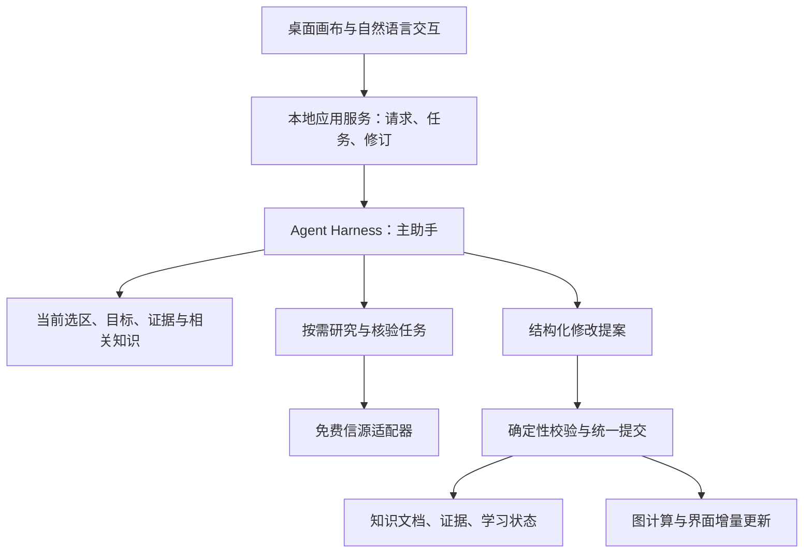

# Agent 架构对比 v0.2

日期：2026-11-18。状态：官方文档调研与讨论建议；没有安装、运行或做框架性能测试。用户已认可其余桌面及传统后端方案，Agent 新选型待确认。

后续更新：用户要求补充 DSH、Hermes、Pi 及衍生架构。本文候选范围不完整，Deep Agents 优先排序不再作为当前结论；参见 [产品型 Agent 架构补充 v0.3](./产品型Agent架构补充-v0.3.md)。保留本文作讨论历史。

## 调整理由与建议

LangGraph 官方定位是低层编排与运行时。“原始”更准确地说是抽象层偏低；并不意味着已经过时。上一版主要考虑可恢复工作流，对现成 Agent 工作环境复用不足。

建议把主开发抽象提高到 Agent Harness：复用模型与工具循环、规划、上下文整理、工作资料、按需委派等能力。当前首选验证 Deep Agents SDK；Pydantic AI Harness 是主要对照候选；Microsoft Agent Framework 保留观察。不叠加三个完整 Agent 生命周期框架。

Deep Agents 底层仍依赖 LangChain / LangGraph，这不是彻底移除 LangGraph，而是减少直接维护状态节点与通用 Agent 设施。若用户希望完全避开该生态，应重新权衡 Pydantic AI Harness。

## 候选比较

| 候选 | 官方能力与项目适配判断 | 待验证或限制 |
|---|---|---|
| Deep Agents SDK | 规划、文件上下文、上下文压缩/大结果外置、子任务委派；SDK 可在自有进程运行，可接自定义工具、后端、持久化检查点。与本地资料工作区和开放研究任务契合，优先验证。 | 必须配置持久检查点及存储；默认内存状态不等于重启可恢复。禁用不需要的通用执行能力，控制委派与调用预算。依赖层较多，Windows 打包与恢复行为需实测。 |
| Pydantic AI + Harness | 类型化 Agent 基础，能力按需组合；已有规划、记忆、上下文管理、子 Agent 等，不能继续仅视为结构化输出封装。适合明确类型的知识补丁与工具接口。 | Harness 官方仍采用 0.x API 策略，次版本可能破坏兼容；本地 StepPersistence 支持 SQLite 等，但快照不包括全部外部状态，步骤中途恢复与 durable execution 另有边界。不能认为接入 SQLite 即完成完整持久执行。 |
| Microsoft Agent Framework | 官方定位为 AutoGen 与 Semantic Kernel 的后继；包含 Agent、Harness、显式工作流、会话与多模型连接。是合理候选。 | 对本项目并无已验证的压倒性优势；需评估所用语言及具体模块的支持状态、最小依赖与本地打包。不能因 Azure 示例就认为必须上云，也不能把某语言预览状态泛化到所有包。 |

以上优先级是结合产品约束的工程判断，不是实测排名。支持多个供应商不代表每个模型的工具调用、结构化输出和压缩能力等价，需要能力检测和降级。

## 产品中的实际工作方式

- 一个主助手维持用户目标和交互连续性。简单问题直接用当前知识回答；信息不足时才启动研究，避免每次聊天都经过长流程。
- 研究策略动态调整：按资料质量与缺口决定继续追踪、更换来源、核验冲突或结束；轮数、时间、调用量与免费来源规则由程序限制，不依赖模型自觉遵守。
- 子 Agent 是可选的任务隔离手段，例如独立核对一组来源；默认不启动一群自由协商的 Agent。返回来源、证据片段、断言和未解决问题，而非只返回一段摘要。
- Harness 的任务计划是内部执行计划；用户的学习目标、先修关系和当前掌握情况仍是领域数据，两者不能混用。
- 临时阅读笔记、计划、压缩上下文与正式认识网络分开。Agent 自己的 memory 不等于用户已经掌握的知识，更不能自动成为已核验事实。
- Harness 使用任务临时区和受控知识读取工具。正式数据修改统一提出 GraphPatch，经类型、稳定 ID、关系约束、证据定位、基础修订检查，再交领域服务提交。类型校验通过不证明内容为真。
- 人工拖拽与 Agent 修改调用同一个提交入口，保留撤销与历史。用户并行编辑时，旧研究结果需要重检或重算，不能覆盖新状态。
- 框架恢复之外仍需稳定操作 ID、提交去重和恢复核对。窗口重开、断网重试不应重复生成同一条知识修订；外部 API 已计费但响应丢失仍可能发生。
- 不把内置付费搜索直接带入第一版，研究工具通过现有免费信源目录与获取策略。正常抓取失败由系统重试、替代或明确说明证据不足。

## 复用边界与验证门槛

复用 Harness 的通用 Agent 能力；领域对象、证据标准、学习状态与修改事务属于本产品，不能依靠换框架省略。框架记忆和状态存储置于适配层后，知识文件格式不绑定框架内部消息类型。迁移运行中的任务仍有成本，不承诺无缝换框架。

后续实现时，用同一个代表任务比较两位主要候选：选中概念并提出需求 → 判断资料缺口 → 自动获取免费原文 → 生成带定位证据的补丁 → 图和文档更新。重点检查：

1. 研究过程中仍可交互，支持取消与预算停止。
2. 强制退出/重启恢复，不丢已提交记录，不重复提交。
3. 用户同时拖拽修改时，正确处理旧修订。
4. 换模型后工具与补丁协议稳定；不可用能力明确降级。
5. Windows 安装包可直接运行，不要求用户配置开发环境。

这只是验证计划，不是本轮已执行的测试。

## 官方依据

- [LangGraph 概览](https://docs.langchain.com/oss/python/langgraph/overview)：低层编排和运行时定位。
- [Deep Agents 概览](https://docs.langchain.com/oss/python/deepagents/overview)：Harness 能力、自托管 SDK 与托管服务的区分。
- [Deep Agents 定制](https://docs.langchain.com/oss/python/deepagents/customization)：模型、工具、结构化输出、后端、检查点等配置。
- [Deep Agents 后端](https://docs.langchain.com/oss/python/deepagents/backends)：状态/文件/组合后端及本机 shell 的边界。目录限制不应误称为所有执行能力的系统级沙箱。
- [Pydantic AI Harness](https://pydantic.dev/docs/ai/harness/)：可组合能力、工作区与 0.x 版本策略；不能无条件照搬 Coder 的文件与 shell 权限。
- [Pydantic 持久化概览](https://pydantic.dev/docs/ai/core-concepts/persistence/)：会话、记忆、步骤快照与持久执行区分。
- [Step Persistence](https://pydantic.dev/docs/ai/harness/step-persistence/)：SQLite 等后端及快照恢复边界。
- [Microsoft Agent Framework](https://learn.microsoft.com/en-us/agent-framework/overview/)：Harness、Agent、工作流及与前序框架的关系。
