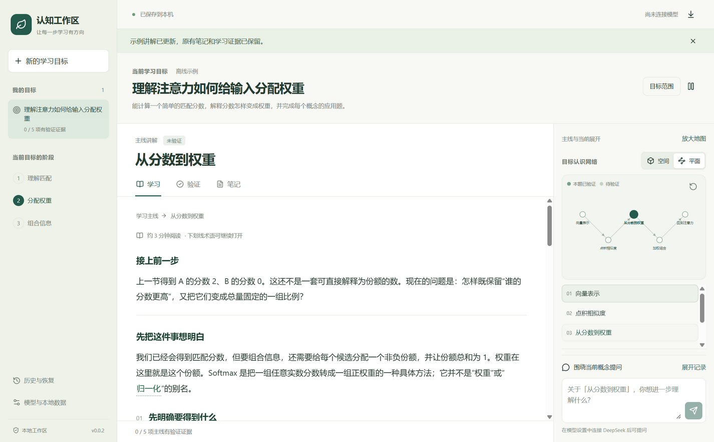

# 认知工作区 · Windows v0.0.2

一个在本机运行的目标式学习桌面应用。当前版本验证「提出目标 → 认识结构 → 学习确认 → 课后验证 → 本地保存」的完整流程，供人工试用和继续迭代。



## 打开应用

- 安装版：从 [最新 Release](https://github.com/yourskenny/cognition-workspace/releases/latest) 下载 `Cognition-Workspace-Setup-0.0.2.exe`，按向导选择目录。
- 直接运行：打开 `release/v0.0.2/win-unpacked/认知工作区.exe`。必须保留整个 `win-unpacked` 文件夹，不能只复制 exe。
- 打包版本已包含 Electron 和 Python 后端，无需另装 Node.js、Python 或开启浏览器。
- 平台：Windows x64。安装包尚未做发布者代码签名。

## 第一次使用

1. 可先点击「先体验『理解注意力』示例」，不调用模型。
2. 「模型与本地数据」中设置 DeepSeek API Key。留空保存会保留已有密钥。请使用自己的密钥；源码与安装包均不含密钥。
3. 输入学习需求，点击「拟定目标」，检查完成依据和范围，再确认开始。此时模型生成 4–5 个主线概念、完整讲解、术语入口、先修关系和课后题。
4. 在空间或平面图中选择概念；空白拖动旋转空间图，滚轮缩放，拖动节点调整布局。节点位置变动不会改变知识关系。
5. 正文是主要阅读区，图在右侧辅助导航。点击下划线术语，先看短解释，再按需逐层展开；返回上层会恢复当前会话的阅读位置。阅读讲解，输入自己的理解或疑问，完成「我理解了」确认后答题。错误和正确回答都留作独立证据。
6. 可以围绕当前概念向模型提问；回答记录可展开阅读。停止任务会保留输入。
7. 笔记需要点击「保存笔记」。自述、答题和图布局自动保存。历史恢复会创建新修订，不删除后来的历史。
8. 每个主线概念都有本题通过记录后，由用户在「目标范围」中确认目标完成。单题通过不等于全面或永久掌握。

旧版离线示例可点击「升级这个示例的讲解」，保留笔记、证据和布局。旧 AI 目标可在每个概念内点击「补全讲解与术语」。补充节点不增加必学数量；示例展开不调用模型，AI 展开会调用模型，结果保存后复用。新版正文更长，首次生成的等待时间和输出用量可能增加；结构不合格时最多自动修复一次，也会产生一次额外调用。建议先退出旧版，再打开新版，避免同时修改同一工作区。

当前「口头确认」落地为自然语言文字输入与明确确认按钮，尚未接入麦克风和语音识别。

## 本地数据与模型调用

默认目录为 `%APPDATA%/cognition-workspace`，通常是 `C:/Users/<用户名>/AppData/Roaming/cognition-workspace`。

```text
cognition-workspace/
  credentials.json                 Windows DPAPI 加密凭据
  desktop/                         窗口与界面缓存
  workspace/
    HEAD.json                      当前已提交修订的指针
    revisions/<修订ID>/
      workspace.json               目标、概念、关系、学习证据、笔记与问答
      学习记录.md                   可阅读的结构化文档
    index.sqlite                   可从文档重建的查询索引
```

退出程序后备份整个 `workspace` 目录，可保留完整修订历史；导出 Markdown 适合阅读和分享，尚不支持从导出文件反向导入工作区。密钥与当前 Windows 用户绑定，换机器需要重新配置。删除本机密钥不会删除学习记录。

模型请求直接发送至 DeepSeek。目标规划发送输入的学习需求；概念问答、补全和展开发送当前目标、选中概念、主线摘要、祖先路径、该概念笔记以及最近相关问答；展开还包含当前术语。凭据只在后端与 Agent 进程内解密使用，不传给界面，不写入项目代码或学习文档。调用第三方模型可能产生其正常 API 费用。

## 实现边界

已经实现：阅读优先布局、结构化长讲解、术语短解释与逐层展开、返回主线、多目标、范围确认、3D/平面视图与拖动、学习确认、选择题验证、笔记、问答、暂停继续、人工完成目标、历史恢复、Markdown 导出、加密密钥和本地持久化。

尚未实现：免费信源自动研究与引用核验、语音输入、任意文件导入、图关系手工编辑与概念合并、间隔复习、真正的工具执行沙箱、Notion 同步、跨设备同步、自动更新。模型生成的讲解与题目均标注「未经信源核验」；确定性校验保证结构合法，不保证知识内容正确。

首版 Agent 使用可替换的 Pi SDK 适配层，运行目标规划、问答、讲解补全和术语展开，不开放 Shell、宿主文件读写或研究工具。Electron 的渲染隔离不是未来 Agent 的执行沙箱。

## 开发与验证

已验证环境：Node.js 24、Python 3.11、Windows x64。

```powershell
npm ci
python -m venv .venv
.venv\Scripts\python.exe -m pip install -r backend/requirements-lock.txt
npm run dev
```

```powershell
npm run build
npm run test:backend
npm run test:desktop
npm run package
npm run test:desktop -- --packaged
npm run test:reading -- --packaged --legacy
npm run installer
```

`npm run package` 会构建前端、冻结 Python 后端并生成可执行目录。`npm run installer` 基于当前构建产物生成 NSIS 安装包；改过后端时先运行 `npm run package`。桌面测试使用 `.test-data` 下独立目录，默认不加载用户凭据、不调用付费模型。

技术分工：React/TypeScript 负责交互，Electron 主进程管理生命周期与窄接口 IPC，Python/FastAPI 负责领域提交，NetworkX 校验先修关系，SQLite 为可重建索引。Agent 在独立 utility process 中运行，任务可停止；模型只能提出结构草案，由确定性校验和用户确认后提交。

实现与验收记录见 `实施记录.md`、`验收记录.md`；原有需求讨论保留在 `需求与讨论记录.md`。

讲解组织与图结构的本轮设计见 `讲解与递归学习设计-v0.2.md`。`npm run test:reading -- --live` 会在隔离目录使用已保存加密凭据，执行真实目标生成与一层术语展开（产生正常 API 用量），结束后删除测试凭据副本。

## 版本与发布

当前公开发行版本为 **0.0.2**（Git 标签 `v0.0.2`）。此前讨论文档里的 v0.2 与本地试用包 0.2.0 是历史迭代标记，保留原记录；公开版本号按 0.0.2 起步。发布内容见 [版本说明](docs/releases/v0.0.2.md)。
