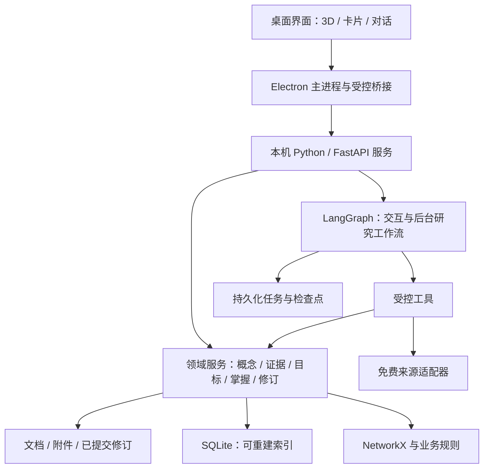

# 桌面后端与 Agent 架构建议 v0.1

日期：2026-11-18。状态：讨论建议，未冻结技术栈，未开始产品实现。

更新：用户随后认可其余方案，要求重新考虑 LangGraph。本文保留最初提案供追溯；其中直接以 LangGraph 为主开发抽象的选型，以及对 PydanticAI 的旧比较，已由 [Agent 架构对比 v0.2](./Agent架构对比-v0.2.md) 更新。新建议为优先验证 Deep Agents SDK，Pydantic AI Harness 为主要对照候选，尚待用户确认。其余桌面与后端方案获得方向性认可，工程可用性仍需验证。

## 建议结论

采用本地模块化后端与可恢复工作流：Electron + React/TypeScript 桌面界面；Python + FastAPI 本地服务；LangGraph 编排 Agent；SQLite 管理索引及独立的运行状态；NetworkX 复用图算法；Trafilatura/Docling 处理资料。通过适配器隔离模型、来源、图计算和渲染。

这是一套待验证的组合，不声称各组件已完成集成测试。桌面技术使用 Web 渲染不改变可本地安装、无需部署网站的产品形态。

## 进程与模块

- 桌面主进程管理窗口、文件选择、安全凭据及本地服务生命周期；界面不能任意读取密钥或直接写知识文件。
- 后端以一个应用组织多个模块，不部署微服务集群。PDF/OCR 等重任务放受管理的工作进程，避免阻塞接口与对话。
- 前端与本地服务之间使用受控桥接。若使用 HTTP，服务只监听本机，采用每次启动的凭据及来源检查；命令走普通请求，进度/提交事件走 SSE，断线后以修订号补取快照。
- Python 运行时与依赖随安装包分发，用户无需安装 Python。PyInstaller 是打包候选，需实际验证依赖、平台构建、启动时间、更新和卸载。Docling 的模型资源按需安装并校验，不默认把所有模型塞入安装包。
- 关闭窗口与退出应用的行为需区分；默认不假设退出后任务仍运行。重启后恢复任务，不承诺电脑关闭时仍执行。

## 桌面壳选择

| 候选 | 判断 |
|---|---|
| Electron | 当前首选：复用 React/Three.js，内置 Chromium 降低不同系统 WebView 带来的差异；代价是包体与内存占用，仍需实测 GPU、驱动与 3D 性能。 |
| Tauri 2 | 备选：可通过 sidecar 打包外部后端，但增加 Rust/系统 WebView/外部进程的集成面。若包体与资源占用成为主要约束再比较，不简单假定总包体更小。 |

## 传统后端：可靠记录、规则计算与统一写入

主要模块：工作区与修订、知识与证据、学习者状态、目标规划、资料接入、图计算、任务管理。

| 能力 | 复用建议 | 我们仍需定义的部分 |
|---|---|---|
| 接口与数据结构 | FastAPI + Pydantic | 领域对象与命令格式 |
| 本地索引、迁移 | SQLite；需要 ORM 时选 SQLAlchemy/Alembic | 稳定 ID、关系与证据索引、版本迁移规则 |
| 关键词检索 | SQLite FTS5 | 中文分词/子串与术语别名策略；不能假定默认 tokenizer 已满足中文 |
| 图遍历与计算 | NetworkX | 先修/构成等语义、环策略、学习缺口与前沿规则 |
| HTML 正文 | Trafilatura | 来源识别、页内定位、质量检查 |
| 复杂 PDF/表格 | Docling 按需启用；普通文本优先轻量提取 | 提取质量回归、证据片段与原页对应 |
| Agent 持久运行 | LangGraph 本地检查点 | 队列入口、取消、预算、任务与目标修订的绑定 |

### 存储约束

- 延续已认可的文档优先方案：已提交 Markdown/结构化记录及修订历史为知识权威记录。数据库中的知识投影可重建。
- **运行状态数据库不是可丢弃缓存**：任务登记、恢复检查点等需持久化与备份。知识索引库与运行状态至少逻辑隔离，可采用不同 SQLite 文件，避免“重建索引”清空任务。
- 所有人工编辑与 Agent 提议经过同一提交服务：读取基准版本 → 验证补丁 → 保存完整修订 → 提交 → 更新投影 → 发布修订事件。
- 单个 SQLite 事务不能自动包住多文件写入。实施时需采用成熟的版本/日志与原子提交模式，设计中间状态恢复；不能把逐文件写入误当整体事务。可评估内部 Git 快照或不可变修订目录，具体机制待小规模验证。
- 每次修改携带稳定操作 ID 与基准修订号。重试不得重复添加节点；基准过期时重读/重新计算，不能让后台旧结果覆盖用户的新修改。
- 规则输出记来源修订和规则版本。无法解析的外部文档保留原文与错误信息，不进入已提交结构，索引继续服务最后有效版本。

### 图计算边界

- 第一版用 NetworkX 的遍历、强连通分量、环、路径等算法，组合自己的领域规则。
- 知识网络允许一般关系有环；先修循环需要显式处理，不对整张图强制 DAG。最短路径不能替代多先修的共同满足条件。
- Datalog 可作为规则接口后面的未来实现。原始材料的 CozoDB/mnestic 首选属于历史建议，本轮不沿用为已决定依赖；是否引入需结合规则复杂度、维护状态、打包和性能验证。
- 3D 布局在视图层，坐标变化不写入知识边。

## Agent：显式工作流与受控工具

首选 LangGraph：其职责是保存任务状态、控制步骤、流式事件与失败恢复，不是认识网络本身。使用开源库在本地嵌入运行，不把 LangSmith 云端或 `langgraph dev` 开发服务器作为用户安装的前置要求。

第一版保留一个面向用户的助手，内部使用可独立恢复的几条工作流；同一个主模型可以承担多个步骤，不需要一开始引入多个自主聊天 Agent。

### 交互工作流

选中对象/用户问题 → 读取目标与相关子图 → 判断现有证据是否足够 → 解释/生成修改提议 → 领域服务校验提交 → 输出绑定对象的解释及图更新。

资料不足时登记后台研究任务，前台返回已有依据下可回答的部分和研究状态。避免把未提交模型文本当成已确认的新知识边；草稿与已提交内容分别标识。

### 后台研究工作流

分析缺口 → 形成研究清单 → 查询来源目录 → 获取与解析 → 提取证据 → 检查支持/冲突 → 预算内迭代 → 产生补丁 → 检查目标和知识版本 → 提交或重新评估。

并行仅用于相互独立的资料获取或子问题；限流、并发和预算统一控制，所有写入仍走提交服务。

### 目标与学习状态工作流

场景/目标变化 → 更新能力需求候选 → 应用已确认约束 → 计算缺口与前沿 → 更新建议。学习困难不自动降低目标，已有掌握历史不因目标缩减删除。

### 工具边界

内部工具示例：`get_subgraph`、`get_evidence`、`search_sources`、`fetch_source`、`compute_frontier`、`propose_patch`。

- 工具调用复用框架；它们调用我们的领域服务，不直接开放整个文件系统或任意 Shell 给模型。
- 模型适配可复用框架 provider 包与供应商 SDK；明确能力矩阵，不将兼容 endpoint 等同于完整支持结构化输出/工具调用。
- Pydantic（数据校验库）与 PydanticAI（另一套 Agent 框架）区分。首版采用 LangGraph 时不同时叠加另一套完整 Agent 生命周期。
- 每个任务保存目标修订、知识基准修订、来源目录版本、工作流版本、证据引用和预算使用情况。升级后任务按兼容策略恢复，不能用新规则无提示续跑旧流程。
- LangGraph 的 checkpoint 不提供业务写入恰好一次保证；本地提交、资料下载等副作用需要稳定操作 ID、幂等处理和状态核对。外部模型请求发生超时不保证可避免重复计费。
- 工具定义、提示、数据 Schema 和规则版本由我们管理；来源文本不作为可执行指令。

## 可借鉴的现有项目

1. [LangGraph](https://docs.langchain.com/oss/python/langgraph/overview)：主运行时候选。显式工作流符合“确定性步骤 + 模型步骤”的分工。
2. [Open Deep Research](https://github.com/langchain-ai/open_deep_research)：借鉴研究分解、检索循环、证据整理和评估。其默认搜索是 Tavily，不能原样视为符合本项目免费信源要求；需替换来源工具，并把最终产物从长报告改为证据和 GraphPatch。文档中使用的开发服务、默认模型与评估费用也不直接搬入产品。
3. [Cherry Studio](https://github.com/CherryHQ/cherry-studio)：参考本地多模型配置、桌面进程和文件工作区组织，不沿用聊天产品布局。当前仓库标明 AGPL-3.0；直接复制/派生代码需评估分发方案，现阶段先参考架构，不默认整仓 fork。
4. [PydanticAI](https://pydantic.dev/docs/ai/overview/)：类型化工具与输出的备选 Agent 框架。如果可恢复流程需求变简单可重新比较；本轮不选两个主框架一起维护。
5. [Tauri sidecar](https://v2.tauri.app/develop/sidecar/)：轻量桌面壳备选实现路线。

AG-UI 可用于模型/工具/状态事件的前端适配，后续根据 UI 组件需求决定是否引入。它不替代工作区提交协议、持久事件和断线恢复。MCP 用于外部工具扩展，内部高频调用优先直接函数/服务调用。

## 必须自己实现的核心

1. 认识网络与证据的领域模型。
2. 补丁校验、统一提交、并发版本判断与撤销语义。
3. 讲解段落/文本区间与稳定对象的双向定位。
4. 目标、掌握状态、缺口和前沿的业务规则。
5. 来源选择与证据接纳政策、领域质量评估。

现成框架承担运行与通用基础能力；这些业务定义决定产品行为，不能靠框架自动生成正确答案。

## 选型验证建议

冻结技术栈前做一条小范围验证：选中概念 → 讲解 → 后台获取一份免费资料 → 证据提取 → 补丁提交 → 3D 局部更新 → 中断/重启恢复 → 同任务重试无重复写入 → 撤销恢复一致版本。

还需验证：Windows 安装包无需额外 Python、模型和解析资源体积、中文检索效果、断网恢复、本机接口边界以及重任务不阻塞画布。本轮未执行这些测试，也未开始编码。

## 主要官方参考

- [Electron 进程模型](https://www.electronjs.org/docs/latest/tutorial/process-model)
- [FastAPI](https://fastapi.tiangolo.com/)
- [LangGraph 概览](https://docs.langchain.com/oss/python/langgraph/overview)
- [LangGraph 持久化](https://docs.langchain.com/oss/python/langgraph/persistence)
- [LangGraph 容错与幂等](https://docs.langchain.com/oss/python/langgraph/fault-tolerance)
- [SQLite FTS5](https://www.sqlite.org/fts5.html)
- [NetworkX 图算法](https://networkx.org/documentation/stable/reference/algorithms/index.html)
- [Trafilatura](https://trafilatura.readthedocs.io/en/latest/)
- [Docling](https://docling-project.github.io/docling/)
- [PyInstaller 打包原理](https://pyinstaller.org/en/stable/operating-mode.html)
